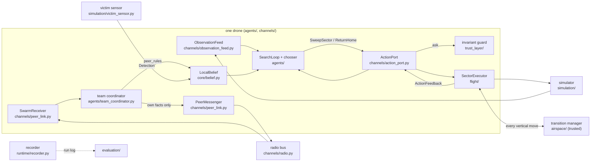

# Architecture

One package, `atal/`, in ten code folders. `runtime/` builds a run out of the other parts,
`core/` is the vocabulary they all share, and each folder in between answers one question.
A drone's agent sees the world only through its channels, and two paths carry everything
it does: an action going out, and a peer's message coming in. The rules for what may
import what are checked by `tests/architecture/test_boundaries.py`.

## Reading order

Read these in order. [walkthrough.md](walkthrough.md) follows one real team run through
the same files with function names and log lines.

1. `atal/runtime/cli.py` and `atal/runtime/run_team.py`: the command, a batch of runs, and the six numbered steps of one run (`run_single.py` is the one-drone version).
2. `atal/runtime/build_drone.py`: every part of one drone and how they are wired.
3. `atal/agents/search_loop.py`: observe, choose, check, act, remember. Then `fixed_chooser.py` or `llm_chooser.py` (what decides) and `team_coordinator.py` (what a team drone adds).
4. `atal/channels/observation_feed.py` and `action_port.py`: the only way in and the only way out of an agent.
5. `atal/trust_layer/invariant_guard.py` and `peer_rules.py`: where a proposal or a peer's claim can be refused.
6. `atal/flight/sector_sweep.py`, `executor.py` and `recovery.py`: how an accepted action is flown, and what happens at an obstacle. `atal/airspace/transition_manager.py`: the trusted service every climb and descent goes through.
7. `atal/core/`: the data types the files above pass to each other.
8. `atal/evaluation/`: what is measured from the run log afterwards.

## The two paths



An action: the search loop asks its chooser for the next action, submits it to its port,
the port asks the gate, an approved action reaches the executor, and the result comes back
to the loop as limited feedback. A peer message: it arrives on the radio bus, is validated
as a typed message (invalid ones are dropped and recorded), the coordinator applies the
peer-claim rules, and the drone's belief is updated, marked as peer-reported.

## What each folder is for

| Folder | Question it answers | Start with |
|---|---|---|
| `runtime/` | How is a run built, started, watched and closed? | `run_team.py` |
| `agents/` | What does one drone decide next? | `search_loop.py` |
| `trust_layer/` | What may be believed, and what may be done? | `invariant_guard.py` |
| `channels/` | How does anything get into or out of an agent? | `action_port.py` |
| `flight/` | How is an accepted action flown, and landed safely? | `sector_sweep.py` |
| `airspace/` | How do drones change altitude without meeting? (trusted infrastructure) | `transition_manager.py` |
| `search/` | Which sectors, in which order, along which lanes? | `voronoi.py` |
| `simulation/` | What is the world, and what is true in it? | `kinematic_sim.py` |
| `attacks/` | How can a message be tampered with in transit? | `hooks.py` |
| `evaluation/` | What happened in a run, measured afterwards? | `run_log.py` |
| `core/` | What are the shared data types? | `mission.py`, `action.py` |
| `configs/` | (data) The bundled missions, scenarios and scenes | `missions/sar/` |

## Dependency rules

Each folder may import only the folders listed. `env.py` and `observability.py` are root
utilities any folder may import. `tests/architecture/test_boundaries.py` checks every row,
the truth rule, the airspace rule and that no file imports another file's `_` names.

| Folder | May import | Must never |
|---|---|---|
| `core/` | nothing else in the package | import the simulator SDK, an LLM SDK or evaluation code |
| `search/` | `core/` | depend on a running drone or the simulator |
| `simulation/` | `core/` | hand the true victim or true peer positions to an agent as an ordinary observation |
| `airspace/` | `core/` | be used by anything but `flight/` and `runtime/`; allocate sectors, read beliefs or count as trust-layer evidence |
| `flight/` | `core/`, `search/`, `airspace/` | decide whether an action is allowed |
| `channels/` | `core/` | import a specific gate, assessor or agent |
| `trust_layer/` | `core/`, `search/` | import `agents/`, `simulation/`, `attacks/`, an LLM, or anything that knows the truth |
| `agents/` | `core/`, `search/`, `trust_layer/` | import `simulation/`, `attacks/` or `evaluation/`; build the rest of the application |
| `attacks/` | `core/` | be imported by `agents/` or `trust_layer/` |
| `runtime/` | everything | contain decision or trust logic; it only builds and runs |
| `evaluation/` | `core/` | control a run; it only reads recorded events |

**Truth stays on the simulator and runtime side.** The hidden victim, true peer
trajectories and tampering labels never reach agent or trust code. The import rule enforces
part of this: agent, trust, search, channel, flight and airspace code never import
`core/scenario.py` or `simulation/`. It does not cover what is passed in as arguments, so
two indirect paths are tracked as open items in
[refactor/baseline.md](refactor/baseline.md): agents hold the run recorder (they only write
to it, but it exposes the log path), and a sector that the trusted transition manager could
not clear for a drone is marked blocked for the whole team, so the manager's decisions can
change which sectors a chooser is offered.

**Beliefs keep their source.** A belief shown to the chooser says whether the drone
verified it itself or a peer reported it.

## Who owns what

Every piece of changing state has one owner. Other code asks the owner.

| State | Owner | Where |
|---|---|---|
| Mission and run settings | the runner; read-only after the run starts | `runtime/run_single.py`, `run_team.py` (parsed options), `core/mission.py` (frozen) |
| One drone's observations and beliefs | that drone's memory | `core/belief.py` (`LocalBelief`) |
| Received peer reports | that drone's receiver | `channels/peer_link.py` (`SwarmReceiver`) |
| Peer claims and who sweeps what | that drone's coordinator | `agents/team_coordinator.py` |
| The command in flight and its result | the action port and the executor | `channels/action_port.py`, `flight/sector_sweep.py`, `flight/executor.py` |
| Vertical-move reservations, pauses, the landing queue | the transition manager | `airspace/transition_manager.py`, `landing_queue.py` |
| Background tasks and cancellation | the run | `runtime/run_team.py`, `runtime/watchers.py` |
| Pad turn-taking and landing confirmation | flight | `flight/pad_zone.py`, `flight/shutdown.py`, `runtime/landing.py` |
| Ground truth and the victim's position | simulator and runtime | `simulation/`, `runtime/` |
| The run log | the recorder (writes), evaluation (reads) | `runtime/recorder.py`, `evaluation/run_log.py`, format in `core/events.py` |

## Who may see what

| Component | Ground truth | Its own drone's delivered observations | Raw payload | Clean (pre-attack) payload / attack details | Other drones' observations |
|---|---|---|---|---|---|
| Agent | No (feedback is ActionFeedback: status + fixed codes, no positions or measured errors) | Yes (its own deep copies) | Yes | No | No: only peer claims delivered on the radio (Remote ID reports, typed peer messages), recorded with their sender |
| Trust / provenance assessor | No | Yes (+ previous one) | Yes | No | No |
| Action-risk gate | No | Yes, the feed's protected record (not the agent's copy), with its trust assessment | Yes | No | No |
| Executor | **Yes** (preflight, settle, corrections) | No | No | No | No |
| Transition manager (trusted, `airspace/`) | **Yes** (every drone's true position and phase, to keep vertical moves apart) | No | No | No | Yes, true positions |
| Recorder / separation | Yes (full CommandResult, snapshots, reasons) | Yes | Yes | Yes | Yes |

The executor deliberately uses simulator ground truth: it plays the role of a
reliable flight controller. Consequence for experiments: when an agent's
observations are corrupted, its commands are still flown accurately, so an
attack shows up as the agent commanding the WRONG target, executed precisely
(see `test_attack_misleads_the_agent_and_executor_flies_the_wrong_target_accurately`).
Experiments that attack the flight controller's own sensing would need a
different executor.

How an agent refers to what it saw: proposals carry an `observation_id`. The
port resolves it through the agent's own feed to the feed's protected record and
rejects unknown ids (including other drones'), altered observation objects,
expired observations (`max_observation_age_s`, checked again after the gate),
observations received before the previous command ended, concurrent submissions
and replayed request ids. Observations are sampled at a fixed rate
(`ObservationFeed.sample`), independent of how often the agent decides; the
evaluator's 20 Hz ground-truth samples are not observations.

Placeholders are explicit, never silent: with no assessor every observation is
`not_assessed`, and with no gate every action is `bypassed` (`assessed=false`).
A run with `bypassed` decisions is an unprotected run, not one where actions
passed a risk check. Conflict decisions will later need permitted traffic
information (peer reports) on a modeled channel; the isolated missions here
don't.

## Conventions

- **Frame:** NED (x north, y east, z down). Positive `vertical_speed_mps` = climbing.
- **Units:** SI inside the system; convert to ft / kt only for display.
- **Heading vs. track:** `heading_deg` is where the nose points (yaw);
  `track_deg` is where the drone moves. A multirotor can differ by any angle.
- **Ground state:** `landed_state` is Project AirSim's raw value and can stay
  `flying` for ~12 s after touchdown. `ground_state` is the operational
  decision. It requires the drone to be still, plus either raw `landed` or a
  slow contact with an upward-facing surface (collision normal z <= -0.7, so
  walls don't count) followed by >= 1 s of stillness near that contact.
  Decisions use `ground_state`, and only from a `valid` snapshot.
- **Freshness:** `telemetry_age_ms` is time since the last pose message;
  `sim_progress_age_ms` is time since the pose timestamp last advanced. Both
  must be under the limit for `valid`, so a frozen or replayed stream goes stale.
- **Validation:** snapshots are always built, even from bad data.
  `validation_status` is `valid`, `stale` or `invalid`; only `valid` should
  ever justify a command. Warnings (collision impacts, landed-state
  inconsistencies) don't change the status.

## Every file

`tests/architecture/test_docs.py` checks that every module of `atal/` is listed here.

```
run_sar_mission.py            one-drone run (wrapper around atal/runtime/run_single.py)
run_sar_swarm.py              team run (wrapper around atal/runtime/run_team.py)

atal/
  runtime/                    building and running a mission
    cli.py                    the atal command: mission, swarm, compare, archive, plot, summarize
    run_single.py             one drone: a batch of runs, and the six steps of one run
    run_team.py               a team on one radio bus, same six steps
    build_drone.py            every part of one drone, wired together
    airspace.py               the team runner's side of the managed airspace
    watchers.py               background tasks: truth record, time limit, stalled simulator, dropout
    landing.py                takeoff, pad turn-taking, descent, shutdown
    acceptance.py             when a run passes, and why it does not
    recorder.py               writes the run log while the run happens
    rates.py                  rates and time limits; scaling for the fast offline simulator
    simulator.py              offline simulator or Project AirSim; finds the scene
    llm_setup.py              choose and ping the model before anything flies
    context.py                what the parts of one run share
  agents/                     the deciding part of a drone
    search_loop.py            SearchLoop: climb, choose, sweep, recover, fly home (every drone)
    fixed_chooser.py          FixedChooser: next sector in the fixed order, no LLM
    llm_chooser.py            LLMChooser: an LLM picks each next sector (prompt, guard, fallback)
    team_coordinator.py       TeamRole + coordinator: claims, clears, finds, re-split of open sectors
    llm/model_config.py       model from LLM_MODEL (any backend), pacing, retries, preflight ping
    llm/rate_limit.py         request pacing for a per-minute quota
    llm/scripted_model.py     scripted stand-in for the LLM (offline runs and tests)
  trust_layer/                what may be believed and what may be done
    invariant_guard.py        SarGuard: the checks every search action must pass
    peer_rules.py             what a peer's "cleared" or "found" may change
  channels/                   the only ways in and out of a drone agent
    observation_feed.py       observations in
    action_port.py            actions out: validate, gate, execute, feedback
    radio.py                  Remote ID bus, broadcasters, receivers
    peer_link.py              send and receive typed peer messages
  flight/                     turning an accepted action into flight
    sector_sweep.py           SectorExecutor: sweep_sector / return_home
    executor.py               command lifecycle: preflight, dispatch, task wait, settle, result
    completion.py             settle predicates, dwell tracker, deadline
    path_follower.py          velocity path follower for polylines
    recovery.py               obstacle recovery through the transition manager
    pad_zone.py               one drone at a time over the landing pads
    shutdown.py               fail-safe shutdown: hover, land, disarm only when on the ground
  airspace/                   trusted flight-safety infrastructure, the same in every condition
    transition_manager.py     every climb, descent, startup and landing is a reservation
    landing_queue.py          how long startups and landings may wait
    bounds.py                 stopping distance and validity times
  search/                     search geometry, no drone state
    voronoi.py                Voronoi partition of the sector grid + coverage order
    allocation.py             split of open sectors between team members
    sweep_lanes.py            lanes for one sector from footprint and overlap
  simulation/                 the world the drones fly in
    airsim.py                 Project AirSim adapter: connect, topics, telemetry snapshots
    kinematic_sim.py          offline point-mass stand-in (faster than real time)
    telemetry_checks.py       deterministic data-quality checks
    victim_sensor.py          footprint detection (the only reader of the victim's true position)
  attacks/hooks.py            in-transit tampering hooks (offset, replay, drop)
  core/                       shared data types
    mission.py                Mission (mission.yaml) and the plan-file loader
    scenario.py               Scenario (scenario.yaml): ground truth, runner and sensor only
    sector_grid.py            SectorGrid and sector ids (A1..H8)
    action.py                 ProposedAction, CommandResult; SweepSector, ReturnHome
    observation.py            Observation, TrustAssessment, GateDecision
    telemetry.py              TelemetrySnapshot
    belief.py                 LocalBelief: the drone's memory, with the source of each fact
    peer_messages.py          SectorClaimed / SectorCleared / SectorBlocked / VictimDetected
    remote_id.py              RemoteIdReport
    contracts.py              the slots: TrustAssessor, ActionGate (+ "none" placeholders), HookContext, PeerSender
    events.py                 the run-log line contract
    paths.py                  bundled files (bundled: names), your own files, ./runs
    strict.py                 the frozen base model of the plan files
  evaluation/                 run evidence, read after a run
    run_log.py                read_run(): load a run log
    sar_metrics.py            time to find, coverage, sectors swept, geofence
    swarm_metrics.py          team metrics: duplicates, message delivery, per-drone work
    separation.py             pairwise separation and collision assessment
    compare.py                paired comparison of batches
    evidence.py               manifest per batch
    archive.py                evidence archive
    plot_tracks.py            top-down SVG of a run
    summarize_run.py          readable run summary
  configs/                    bundled, read-only: missions/sar/*.yaml, sim_config/*.jsonc
  observability.py            optional Logfire tracing (LOGFIRE_TOKEN)
  env.py                      load ./.env (or the checkout's) without printing it

legacy/                       code from before the search and rescue work; atal/ never imports it
tests/                        one folder per atal/ folder, plus architecture/; shared fakes at the top
tools/reference_cases.py      offline reference runs used to check the restructuring
tools/live_alt_report.py      live altitude-hold comparison of run batches (follower traces, separation, landings)
search_and_rescue_stack.py    Sam's SAR prototype (only its imports are ever edited)
```
