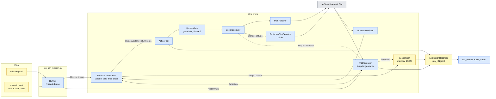
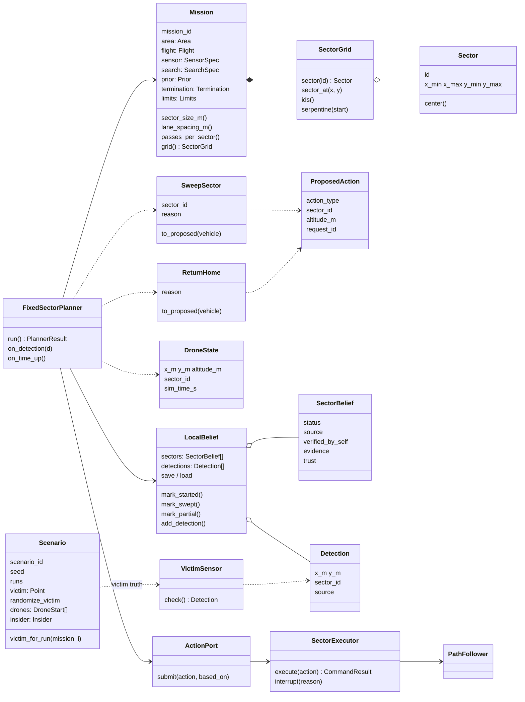

# Phase 1: one drone, no LLM

Goal (deck slide 11): prove the simulation pipeline before any AI enters. **Done when** the
drone sweeps every sector and detects the victim in 10 runs in a row.

Everything in this phase is plain, deterministic code. Phase 2 replaces exactly one box,
the fixed-list planner, with a Pydantic AI agent whose output type is the same typed
actions, so the port, executor, memory and logs carry over unchanged.

## What was built

| Deliverable (10/28 meeting) | Where |
|---|---|
| Repository with the simulation harness | `run_sar_mission.py` (one command, N seeded runs, live or `--offline`) |
| Mission file and Pydantic data models | `missions/sar/*.yaml`, `atal/core/sar.py`, `atal/core/belief.py` |
| Run logs for each mission | `runs/sar/<batch>/run_NN.jsonl` + `.memory.json` + `.summary.json` + `.svg`, `batch_summary.json` |
| Class / module diagram | this page (below) |
| Short demo video | to record on zeus-g, see [Demo video](#demo-video) |

| Piece | File | Notes |
|---|---|---|
| Mission / scenario models | `atal/core/sar.py` | Slide 13 YAML, validated by Pydantic; errors name the field |
| Sector grid | `atal/core/sar.py` (`SectorGrid`) | ids A1..H8, bounds, lookup, serpentine order |
| Voronoi coverage | `atal/search/voronoi.py` | the only search algorithm (decided 10/29) |
| Boustrophedon lanes | `atal/search/sweep_lanes.py` | lanes from footprint and overlap |
| Victim sensor | `atal/simulation/victim_sensor.py` | footprint geometry; camera detection later |
| Memory (local belief) | `atal/core/belief.py` | swept sectors and detections, each with its source |
| Typed actions | `atal/core/sar.py` (`SweepSector`, `ReturnHome`), `atal/core/action.py` | go through the action port like any agent action |
| Sector executor | `atal/flight/sector_sweep.py` | sweeps with the live-tested velocity path follower |
| Fixed-list planner | `atal/agents/sector_planner.py` | the Phase 1 "agent" |
| Offline simulator | `atal/simulation/kinematic_sim.py` | point-mass stand-in for AirSim, faster than real time |
| Metrics | `atal/evaluation/sar_metrics.py` | time to find, coverage, sectors swept |
| Top-down plot | `atal/evaluation/plot_tracks.py` | SVG; also plots Phase 0 corridor runs |

## Conventions

- **Frame:** simulator NED. `x_m` = north, `y_m` = east, meters. The grid's `origin` is its
  minimum-x, minimum-y corner.
- **Sector ids** read like a chess board on a north-up map: the letter is the column along
  y (east), the number is the row along x (north). A1 is the origin corner, B1 is east of
  it, A2 north of it, H8 is the far corner. The deck's victim at (430, 560) is in **F5**.
- **Derived in code, not YAML:** sector size = area / sectors (100 m); lane spacing =
  footprint × (1 − overlap) (48 m); passes per sector = ceil(sector size / spacing) (3).
- **The victim never goes in the mission file.** `scenario.yaml` is read only by the
  runner and the simulated sensor. The planner learns about the victim only from its own
  sensor's `Detection`, which carries the drone's position, not the victim's.

## Module architecture

Colors follow the deck: deterministic code (blue), external (grey), data (yellow).



## Class diagram



## Search algorithm

1. **Voronoi partition** (`voronoi_partition`): each sector goes to the drone nearest its
   center (ties to the smallest id). One drone owns all 64 sectors; with three drones in
   Phase 3 the same call splits the grid, and it can be recomputed over the sectors still
   open when a sector clears or a drone drops out.
2. **Order inside a drone's cells** (`coverage_order`): serpentine by rows from the end of
   the cell nearest the start, each row from its nearer end. On the full grid from A1 this
   is A1..H1, H2..A2, A3..H3, and so on (the mission's `sector_order: serpentine`).
3. **Boustrophedon sweep of each sector** (`sweep_path`): `passes_per_sector` lanes along y,
   evenly spaced, inset from the sector edge so the footprint still overlaps the next
   sector; the start corner is the one nearest the drone, so sectors chain with short
   transits.

## Running it

```bash
# offline, no simulator (kinematic sim at 50x real time)
python run_sar_mission.py --offline --mission missions/sar/mission_dev.yaml --scenario missions/sar/scenario_dev.yaml
python run_sar_mission.py --offline --speedup 100                       # the deck's 800 m mission
python run_sar_mission.py --offline --full-sweep --runs 1               # keep sweeping after the find

# live (Project AirSim running, scene sim_config/scene_sar_one_drone.jsonc)
python run_sar_mission.py --mission missions/sar/mission_dev.yaml --scenario missions/sar/scenario_dev.yaml --runs 1

# one run's plot again, or a Phase 0 corridor run's plot
python -m atal.evaluation.plot_tracks runs/sar/<batch>/run_00.jsonl
```

PASS for a run: the victim was detected, the search did not end in a failure (`ended_by`
is not failed / aborted; a find never hides a later failure), the return home reached home,
the drone landed, stayed inside the geofence and had no impact, the run log is complete and
did not end `aborted`, no exception reached the runner (a crash after a successful search
still fails the run), the descend before landing succeeded and no background task (feed,
sensor, truth sampler, time watch) died. With `--full-sweep`, every
sector must also be swept AND the measured footprint coverage must reach `--min-coverage`
(default 95%; truth gaps over 3 s are not interpolated). The 95% is an engineering
acceptance threshold on an approximate raster (cells of footprint / 10), not proof that every
point was seen; the team should agree on the tolerance. A failing run prints its reasons
and `batch_summary.json` lists them per run (`fail_reasons`). The table at the end shows each
run's outcome, victim sector, time to find (sim seconds), sectors swept and area coverage.

## Offline results (kinematic sim, 2026-11-02)

These check the pipeline, not flight performance: the kinematic sim is a point mass with an
acceleration limit, no wind, no buildings.

| Mission | Runs | Result | Time to find (sim) |
|---|---|---|---|
| `mission_dev` (160 m, random victim per run) | 10 | 10 of 10 found, landed, no geofence breach | 101-1020 s |
| `mission_dev --full-sweep` | 10 | 10 of 10 found, all 64 sectors swept, 100% area coverage, landed | 144-1047 s |
| `mission.yaml` (deck, victim F5) | 2 | 2 of 2 found | ~2805 s (37 of 64 sectors) |
| `mission.yaml --full-sweep` | 1 | victim found, but only 48 of 64 sectors before `max_mission_time_s: 3600` | |

## Run length: the deck's numbers don't fit in an hour

At 5 m/s with 60 m altitude, the full 800 × 800 m sweep is about 19 km of track including
turns and transits, about **80 minutes**, so `max_mission_time_s: 3600` stops it after 48 of
64 sectors. Finding the victim at F5 takes ~47 minutes. Ten real-time runs on the deck
mission would take 8-13 hours. Options, for the team to choose:

- raise `flight.speed_m_s` (the follower takes up to 20 m/s; Simple Flight needs a live check),
- use `mission_dev.yaml` (same 8 × 8 grid, 160 m; ~13 min per full sweep) for shakedowns
  and the demo video,
- raise `max_mission_time_s` to ~5400 for the deck mission,
- run batches in parallel on the two lab machines.

## Live checklist (zeus-g)

1. **Spawn point and area.** `scene_sar_one_drone.jsonc` spawns Drone1 at (0, 0) and the grid
   starts there. In CityEnviron this may be inside or next to a building (the corridor
   scene's drones hit buildings at 30 m). Pick a clear spot, set the scene's `xyz` and the
   mission's `area.origin` and the scenario's `start` to match. The runner refuses to fly if
   the drone spawns more than 5 m from the scenario start.
2. **Altitude.** 60 m does not clear CityEnviron: at the default spawn the dev grid's row 2
   runs into the wall of `Apartment_Square_Tower3` (moving the grid 40 m west didn't help;
   the tower spans the east side). `mission_dev.yaml` flies at 150 m, which swept cleanly
   on zeus-g (2026-11-02: victim found at 699 s sim, 32 of 64 sectors, landed, PASS).
   Detection is footprint geometry, so altitude does not change it in Phase 1. Check the
   deck's 800 m mission (`mission.yaml`, still 60 m) the same way before running it live.
3. Start with `mission_dev.yaml --runs 1`, then `--runs 10`.
4. Open the run's `.svg` to check the track against the lanes.

## Demo video

Record the VNC session on zeus-g while a `mission_dev` run flies (for example with a screen
recorder on the machine running the VNC viewer, or `ffmpeg -f x11grab -i :1 demo.mp4` if
ffmpeg is available in the container), and show the
run's `.svg` and `batch_summary.json` at the end. A victim marker in the scene is optional:
detection in Phase 1 is geometric, so the victim does not need to be a visible object yet.

## What Phase 2 changes

- `FixedSectorPlanner` is replaced by a Pydantic AI agent whose output type is
  `SweepSector | VerifySector | ReportVictim | ReturnHome` (add the last two to `SarAction`).
- The invariant guard goes in the port's gate slot (it replaces `BypassGate`), and again as
  the agent's output validator.
- The executor, memory, sensor, runner, logs and metrics stay as they are.
