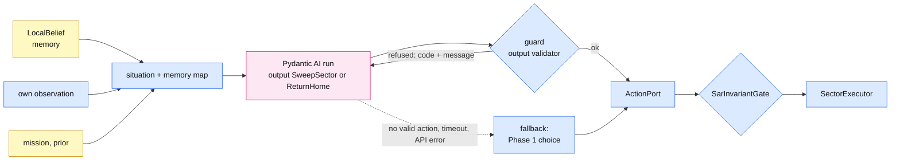

# Phase 2: one LLM drone

Goal: the same single-drone search as [Phase 1](phase1.md), with an LLM choosing which sector
to search next. Everything else stays the same code: the climb, the action port, the sector
executor, the sensor, the memory, stop on detection or time limit, the return home, the run
log and the metrics. One more thing differs by default: `--gate auto` puts the invariant
guard in the gate slot for the LLM planner but keeps Phase 1's bypass for the fixed planner.
`--gate none` bypasses only the execution-side gate; the LLM planner's output validator
always runs (it is part of the planner, not a defense switch). **For a fair comparison run
both with `--gate invariants`**: the fixed planner then takes the
next sector in its order that the guard allows, so both planners run under the same rules,
limits and termination, and differ only in which sector comes next.

```bash
# live (zeus-g): LLM_MODEL in .env, or --model
python run_sar_mission.py --planner llm --mission missions/sar/mission_dev.yaml \
    --scenario missions/sar/scenario_dev.yaml --runs 1
python run_sar_mission.py --planner llm --model ollama:qwen3.5:9b --thinking off ...

# offline, no model server: the scripted stand-in model
python run_sar_mission.py --planner llm --model scripted --offline \
    --mission missions/sar/mission_dev.yaml --scenario missions/sar/scenario_dev.yaml
```

## What was built

| Piece | File | Notes |
|---|---|---|
| LLM planner | `atal/agents/llm_chooser.py` (`LLMChooser`, logged as `LLMSectorPlanner`) | Pydantic AI, any model (`atal/agents/llm/model_config.py`); replaces only the chooser of the Phase 1 search loop |
| Invariant guard | `atal/trust_layer/invariant_guard.py` (`SarGuard`, `SarInvariantGate`) | the agent's output validator AND the port's gate slot |
| Scripted model | `atal/agents/llm/scripted_model.py` | Pydantic AI `FunctionModel`: offline runs and tests |
| TestModel | `--model test` | Pydantic AI `TestModel`: schema-shaped nonsense, so every decision is refused and falls back (plumbing test) |
| Planner loop | `atal/agents/search_loop.py` | the loop asks its chooser's `choose()` for each next action; Phase 1's `FixedChooser.choose()` is "next in the fixed order" |
| Runner | `run_sar_mission.py` | `--planner llm`, `--model`, `--thinking`, `--decision-timeout` |
| Metrics | `atal/evaluation/sar_metrics.py` | decisions, fallbacks, guard and gate refusals, decision latency |
| Tracing | `atal/observability.py` | Logfire spans per run and per decision when `LOGFIRE_TOKEN` is set |

## One decision



- **Input.** Each decision is a fresh, short model run. The prompt is rebuilt from the drone's
  memory every time: own position, time used and left, a text map of the grid (`#` swept,
  `.` unsearched, `~` partly swept), the eight nearest unsearched sectors with distance and an
  estimated time, and, if the mission enables a prior, the most likely unsearched sectors.
  Memory is the belief file, not the chat history, so the prompt does not grow over a long
  search and what the model knows is exactly what `run_NN.memory.json` says.
- **Output.** A typed action, `SweepSector | ReturnHome` (`atal/core/action.py`). There are no tools:
  the model never calls the simulator.
- **Guard.** The output validator runs the guard. A refused choice goes back to the model with
  the rule's code and message (for example `already_swept: A1 is already swept (your memory)`),
  up to 2 retries.
- **Fallback.** No valid action after the retries, a timeout (`--decision-timeout`, 60 s) or an
  API error: the drone takes the Phase 1 choice (next unsearched sector in serpentine order)
  and the decision is logged with `fallback: true`. A failing model never leaves the drone
  without a next step.
- **Gate.** The same guard sits in the port's gate slot (`SarInvariantGate`, assessed: every
  decision is APPROVED or REJECTED, never BYPASSED). Nothing that breaks a rule reaches the
  executor even if a planner skipped the validator, with one deliberate exception: the gate
  always lets a drone go home (a trusted-controller privilege, since home is the safe action
  after a failure). So `premature_return` is a planner-level rule, enforced by the
  validator only: a planner that skips it can end its search early, but never fly an
  invalid sweep.
- **Stop is durable.** A detection or the time limit that arrives while the model is still
  deciding ends the search: the loop re-checks after every decision, and the guard refuses
  any sweep once the victim is detected (`search_over`).

## Guard rules

| Code | Rule |
|---|---|
| `unknown_sector` | the sector id is not in the mission grid |
| `not_assigned` | the sector is outside the drone's Voronoi cells (all 64 with one drone) |
| `already_swept` | the drone's memory marks it swept |
| `not_enough_time` | flying there, sweeping it and flying home would overrun `max_mission_time_s` |
| `search_over` | a sweep after the victim was detected (stop on detection) |
| `premature_return` | return home while sectors still fit in the time and the victim is not found |
| `wrong_altitude` | change altitude to anything but the mission altitude |
| `not_allowed` | any other action type |

Time estimate: straight transit + the sector's lanes + straight flight home, divided by the
flight speed, times 2 (live CityEnviron sweeps took about twice the straight-line time),
plus 30 s reserve.

This is a **validity** guard: it uses only the drone's own observation, memory and the
frozen mission. Trust checks on peers' claims and human approval belong to Phase 5.

## What the run log adds

Every decision is an `llm_decision` event: model, latency, the choice and the model's
reason, the exact prompt it was given, the guard's refusals
(choice, code, message), whether the fallback was used and why, token usage, sim time, how
many sectors were open, and what the Phase 1 planner would have chosen
(`serpentine_choice`). Model-level retries and rate waits are logged as before
(`source: model`). The per-run summary and the batch table add `llm_decisions`,
`fallbacks`, `guard_rejections`, `gate_rejections` and decision latency (mean, max, total).

Note that **time to find includes thinking time**: the drone hovers while the model decides,
and sim time keeps running. With qwen3.5:9b at ~5-10 s per decision and thinking on, 30
decisions add several minutes; `--thinking off` is the first thing to try.

## Logfire

Set `LOGFIRE_TOKEN` in the repo's `.env` (create a write token in the Logfire project
settings). The runner then prints `Logfire tracing on` and traces:

- `sar run N`: one span per run (mission, planner, model);
- `sar decision N`: one span per decision (unsearched count, sim time), with the model
  request(s) and output validation nested under it by Pydantic AI's instrumentation.

To read a decision in Logfire, expand `sar run N` (the number badge on the row is how
many spans are nested under it), then `sar decision N` → `agent run` → `chat <model>`. The
chat span shows the system instructions, the situation prompt and the model's reply,
including its `reason`. With `--thinking off` there is no separate reasoning text; with
thinking on, qwen's reasoning appears in the reply if the model returns it.

Without a token nothing is sent and runs are unaffected. The JSONL run log stays the
experiment's source of truth; Logfire is for watching runs live and browsing prompts.

## Offline results (kinematic sim, scripted model, 2026-11-02)

Same 10 seeds (`mission_dev.yaml` at 150 m, random victim per run), speedup 100:

| Planner | Result | Time to find, mean (min-max), sim s | Fallbacks |
|---|---|---|---|
| `--planner fixed` (Phase 1) | 10 of 10 found and landed | 650 (175-1310) | |
| `--planner llm --model scripted` (greedy nearest) | 10 of 10 found and landed | 746 (210-1317) | 0 |
| `--model scripted:stubborn` (proposes a swept sector first) | guard refusals sent back, model fixes them | | 0 |
| `--model scripted:broken` (never answers) | found; every decision fell back to the Phase 1 order | | all |

`python -m pytest` blocks real model requests for the whole suite
(`tests/conftest.py`, `ALLOW_MODEL_REQUESTS = False`), so no test can call an LLM by accident.

Two expected weaknesses of the greedy stand-in, not pipeline faults: with `--full-sweep` it
ends at 62-63 of 64 sectors on `mission_dev.yaml` (the nearest-first path leaves stragglers,
and the last ones no longer fit in 1800 s; the serpentine order sweeps all 64), and on the
deck's `mission.yaml` (fixed victim in F5) it reaches F5 in 1 of 10 runs before 3600 s,
against 10 of 10 for the serpentine order (~2790 s). Full-sweep acceptance is a Phase 1
check; for the LLM planner, compare time to find on the same seeds.

The scripted model is a greedy "nearest unsearched sector" policy, not an LLM: these rows
check the pipeline (guard, retries, fallback, logs), not search quality. With no prior the
serpentine order is already a good coverage path; an LLM can only beat it with information
the fixed order does not use, such as the prior (`prior.enabled` in the mission file).

## Live checklist (zeus-g)

1. Ollama running (runbook), `LLM_MODEL=ollama:qwen3.5:9b` in `.env`.
2. `--runs 1 --thinking off` on `mission_dev.yaml` and watch the decisions print.
3. Compare with thinking on, and with qwen3.5:27b if the GPU allows.
4. For the research question, run the same seeds with `--planner fixed` and `--planner llm`
   and compare `time_to_find_s` in the two `batch_summary.json` files.

## Not in Phase 2 yet

- `VerifySector` and `ReportVictim` from the deck's action list: with one drone, detection is
  the drone's own sensor and stops the search by itself, so there is nothing to verify or
  report to. They come with peers in Phase 3.
- Human approval of consequential actions (Phase 5, with a scripted operator in experiments).
