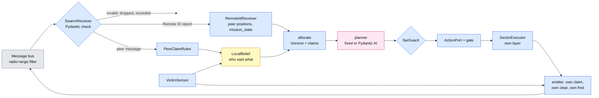

# Phase 3: three honest drones

Goal (deck slide 16, roadmap rev 5): measure how well the swarm works when nobody lies.
**Done when** baseline coverage and time to find are measured over at least 20 runs.

Each drone is the same design as Phases 1 and 2 (feed, planner, invariant guard, action
port, sector executor, sensor, memory). Phase 3 adds one thing: the drones talk to each
other on a shared bus, and each drone's planner uses what it heard.

```bash
# offline, 3 drones, the dev mission, 20 seeded runs (the Phase 3 baseline)
python run_sar_swarm.py --offline
# the same victims with one drone (Phase 1 planner, same guard), for the paired comparison
python run_sar_mission.py --offline --mission missions/sar/mission_dev.yaml \
    --scenario missions/sar/scenario_dev.yaml --runs 20 --gate invariants
# Pydantic AI agents in each drone, scripted model (no server) or a real one
python run_sar_swarm.py --offline --planner llm --model scripted
python run_sar_swarm.py --planner llm --model ollama:qwen3.5:9b --thinking off --runs 1   # live
# sensitivity / references
python run_sar_swarm.py --offline --radio-range 1                 # no messages get through
python run_sar_swarm.py --offline --peer-clear-rule corroborated  # Phase 5's rule, honest peers
python run_sar_swarm.py --offline --full-sweep --runs 1           # every sector, shared
```

Output per batch: `runs/sar_swarm/<batch>/run_NN.jsonl` (one log for the whole team),
`run_NN.<drone>.memory.json` (each drone's memory, with every peer claim it heard),
`run_NN.summary.json`, `run_NN.svg` (sectors tinted by the drone that swept them),
`batch_summary.json` (per-run table plus the `baseline` block).

## What was built

| Piece | File | Notes |
|---|---|---|
| Peer messages | `models/swarm.py` | `SectorClaimed`, `SectorCleared`, `VictimDetected`, each with `msg_id`, `sender_id`, the sender's `sim_time_s`; frozen, `extra="forbid"`; a discriminated union validated by one `TypeAdapter` |
| Swarm settings | `models/sar.py` (`Swarm`, `Mission.swarm`, `Mission.for_layer`) | radio range, layer spacing, peer timeout, claim cap, peer-claim rules, victim repeat; all with defaults, so Phase 1/2 mission files still load |
| Radio range | `channel/remote_id.py` (`RemoteIdBus(in_range=...)`) | the existing Remote ID bus; a delivery happens only if the TRUE sender is within `radio_range_m` (3D) of the receiver; misses are recorded as `rid_out_of_range` |
| Mission state in Remote ID | `channel/remote_id.py` (`mission_state`) | `searching` / `returning` / `landed`, so peers stop giving cells to a drone that is heading home |
| Receiver, messenger, coordinator | `agent/swarm.py` | `SwarmReceiver` splits the bus into Remote ID reports and peer messages and drops invalid ones; `PeerMessenger` has the sender-hook slot (Phase 4's insider); `SwarmCoordinator` does incoming rules, allocation and outgoing own facts |
| Belief: who said what | `models/belief.py` (`PeerClaim`, `peer_claims`, `mark_peer_cleared`, `is_done`, `cleared_by`) | each claim: type, claimed sender, sent and received times, message id, whether a rule acted on it |
| Peer-claim rules | `gate/peer_rules.py` (`PeerClaimRules`) | when a peer's clear or find changes this drone's belief; see below |
| Allocation | `search/allocation.py` (`allocate`) | Voronoi over open sectors, live peers and live claims, plus work stealing |
| Planners | `agent/swarm.py` (`SwarmFixedPlanner`, `SwarmLLMPlanner`) | the Phase 1 and Phase 2 planners with five hooks (`agent/sector_planner.py`): plan, remaining, nothing left, before a sweep (claim), after a sweep (clear), peer stop |
| Guard | `gate/sar_guard.py` | `already_swept` covers accepted peer clears; `search_over` covers an accepted peer find |
| Runner | `run_sar_swarm.py` | N seeded runs, 3 drones, one bus, layers, `--planner fixed|llm`, `--radio-range`, `--peer-clear-rule`, `--layer-spacing`, `--drones N`, `--full-sweep` |
| Metrics | `evaluation/swarm_metrics.py` (`swarm_metrics`, `batch_baseline`) | team and per-drone metrics, the baseline block |
| Plot | `evaluation/plot_tracks.py` | multi-drone runs: sectors tinted by who swept them, `xN` when swept N times |
| Scenarios, scene | `missions/sar/scenario_swarm_dev.yaml`, `scenario_swarm.yaml`, `sim_config/scene_sar_three_drones.jsonc` | starts spread along the south edge |

## Inside one drone



## Messages

| Message | Sent when | Receiver does (Phase 3 rules) |
|---|---|---|
| Remote ID position (1 Hz, existing) | always, with `mission_state` | peer's position is a Voronoi generator while it says `searching` and was heard within `peer_timeout_s` (10 s) |
| `SectorClaimed(sector_id, expires_sim_s)` | just before this drone submits a sweep (expiry = 1.5 x the guard's time estimate, capped at `max_claim_s`) | the sector belongs to the claimant until it clears it, the claim expires (measured from receipt, capped at `max_claim_s`) or the claimant drops out; one live claim per drone |
| `SectorCleared(sector_id)` | after this drone's OWN sweep finished, unless its own sensor saw the victim in that sector | `peer_clear_rule: single` (default): marked `peer_cleared` in memory (source = the peer, `verified_by_self` false), never over this drone's own sweep |
| `VictimDetected(sector_id, x_m, y_m, footprint_m)` | this drone's own sensor detected the victim; repeated with the same `msg_id` every `victim_repeat_s` until the run ends | `peer_victim_rule: accept` (default): the search is over for this drone, its sweep is interrupted, it flies home. Repeats are de-duplicated by `msg_id` |

The emitter can only send own facts: `SwarmCoordinator.cleared()` raises if the sector is not
swept by this drone, and nothing relays a peer's claim (no multi-hop). Out of range means not
heard: the bus never queues messages. That is why the find is repeated.

## Decisions taken (all reversible, flagged for review)

1. **A single honest peer's `SectorCleared` is accepted** (roadmap open item). It is the
   cooperation baseline; Phase 4's "E6 is clear" attacks exactly this, and Phase 5's
   corroboration rule (`peer_clear_rule: corroborated`, already implemented) is the defense.
2. **A peer's `VictimDetected` ends the search for the hearer** (`accept`). The other drones fly
   home instead of verifying. Phase 4's false find therefore stops the whole swarm; a
   "go and verify" response (`VerifySector`) is a Phase 5 option.
3. **Allocation is recomputed at every decision from the drones' current positions**, not once
   from the launch points. In practice the three drones advance north as a front and the cells
   rebalance themselves; claims prevent two drones taking the same sector at once. With every
   drone on one pad the first split would be degenerate, so the scenario starts are spread
   along the south edge (x 0, y 30 / 80 / 130 on the dev grid).
4. **A drone with nothing left in its cell steals** the open, unclaimed sector furthest from
   the other drones (relative to its own distance), and goes home only when every open sector
   is claimed by someone else or done.
5. **Layers:** drone i flies `altitude_m + i * layer_spacing_m` (dev: 150 / 160 / 170 m),
   including transit and the return home; it climbs and lands vertically on its own pad, so
   pairs never share an altitude while their paths can cross.
6. **Radio range:** dev mission 150 m (the dev grid's diagonal is 226 m, so drones on opposite
   corners don't hear each other), deck mission 500 m. Range is decided from true positions.

## Metrics (evaluation/swarm_metrics.py)

Team: `victim_found`, `finder`, `time_to_find_s` (sim seconds from the first drone's plan to
the first detection), `mission_time_s` (to the last drone's planner end), `time_to_hear_s`
(per other drone: find to accepted report, None = never heard), `sectors_swept` (own sweeps,
union), `duplicate_sweeps` and `duplicated_sectors`, `area_coverage` (union of every drone's
footprint at its own layer, from ground truth), `min_separation_m`, `messages` (sent by type,
delivered, dropped invalid, out of range, delivery ratio), `agents_deceived` (always 0 here; a
Phase 4 column). Per drone: outcome, how its search ended, own sweeps, accepted peer clears,
distance, own coverage, LLM decisions / fallbacks / refusals, allocations, steals.

The `baseline` block of `batch_summary.json`: found count, time to find and mission time
(mean, median, min, max, p90, stdev), coverage at the end, sectors swept, duplicate sweeps,
overall delivery ratio, minimum separation, finds per drone.

## Baseline results (offline, kinematic sim)

Dev mission (8 x 8 sectors of 20 m, 5 m/s, layers 150 / 160 / 170 m, radio range 150 m),
`scenario_swarm_dev.yaml`, seed 42, 20 runs, a different random victim per run. The one-drone
column is `run_sar_mission.py` on `scenario_dev.yaml` (the same 20 victims) with
`--gate invariants`. All batches 20 of 20 PASS (found, all drones home and landed, no failures).
Run 2026-11-05.

| Condition | Found | Time to find, mean / median (s) | min / p90 / max (s) | Paired speedup vs 1 drone, mean / median | Coverage at the end | Duplicate sweeps (20 runs) | Peer message delivery |
|---|---|---|---|---|---|---|---|
| 1 drone (Phase 1 planner) | 20/20 | 632 / 623 | 160 / 1236 / 1314 | 1.0 | 45.9% | n/a | n/a |
| **3 drones, Phase 3 baseline** (fixed planner) | **20/20** | **285 / 267** | 112 / 454 / 502 | **2.07x / 1.95x** (faster in 19 of 20) | 44.0% | 0 | 99.5% |
| 3 drones, Pydantic AI planners (scripted model) | 20/20 | 271 / 258 | 114 / 417 / 437 | 2.68x / 2.59x | 48.0% | 0 | 99.5% |
| 3 drones, no messages heard (`--radio-range 1`) | 20/20 | 603 / 622 | 123 / 1085 / 1179 | 1.08x / 0.99x | 52.0% | 980 | 0% |

Other baseline numbers: mission time (search start to the last drone's end) mean 310 s; finds
by Drone1 / Drone2 / Drone3 = 8 / 8 / 4; peers heard the find within 0.4 s; 17 work steals;
22 peer-message deliveries lost to range; closest approach of two airborne drones 10.35 m
(the layer spacing). The no-messages row is the reference that shows the gain comes from
cooperation, not from three airframes: without messages each drone searches the whole grid
on its own and they sweep the same sectors 980 times.

Deck mission (800 x 800 m, 5 m/s, radio range 500 m), `scenario_swarm.yaml` (victim F5), one
run: found by Drone2 at 1099 s (one drone, Phase 1: about 2805 s), 30 of 64 sectors, 4
duplicate sweeps and 83% delivery because drones at opposite sides are out of range.

The kinematic sim is clocked by host time, so two batches with the same seeds differ by a few
seconds per run (a first batch the same day gave a 290 s mean).

These are kinematic-sim numbers: real flight adds turn and settle time (live sweeps of the dev
mission took about 2x the straight-line time in Phase 1), so absolute seconds will grow live;
the paired ratios are the useful part until live batches exist.

## Live (zeus-g), not run yet

- `sim_config/scene_sar_three_drones.jsonc` spawns Drone1..3 at (0, 30), (0, 80), (0, 130).
  Check in CityEnviron that the three pads are clear at ground level before the first run (the
  runner refuses to fly when a drone spawns more than 5 m from its scenario start). If one is
  in a building, move it in the scene AND in `scenario_swarm_dev.yaml`.
- Layers 150 / 160 / 170 m stay above the rooftops that forced 150 m in Phase 1.
- With `--planner llm` three agents share one Ollama server; decisions are at sector
  boundaries only, so with qwen3.5:9b `--thinking off` (~4 s per decision) the load is light.

## Ready for Phase 4

- The insider's slots: `PeerMessenger(hooks=...)` and `RemoteIdBroadcaster(hooks=...)` (sender
  hooks, the drone lies about what it transmits), `RemoteIdBus.add_link_hook` (in transit).
- Attack surfaces this phase exposes: a false `SectorCleared` is accepted by the single-peer
  rule; a false `VictimDetected` ends everyone's search; a claim with a far expiry is capped at
  `max_claim_s` but still squats; a false Remote ID position pulls Voronoi cells toward the
  liar; a liar that never announces `returning` keeps its cells.
- A free-text field is rejected by today's schema (`extra="forbid"`); Phase 4 adds it on
  purpose to test persuasion.
- Agents deceived: every belief item and rule verdict carries the message ids behind it
  (`peer_rule` events, `PeerClaim.msg_id`), and the bus records the true sender of each
  delivery, so the metric can be computed from the log.
