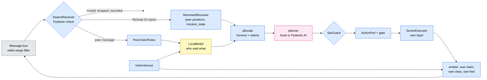

# Phase 3: three honest drones

Goal (deck slide 16, roadmap rev 5): measure how well the swarm works when nobody lies.
**Done when** baseline coverage and time to find are measured over at least 20 runs.

Each drone is the same design as Phases 1 and 2 (feed, planner, invariant guard, action
port, sector executor, sensor, memory). Phase 3 adds one thing: the drones talk to each
other on a shared bus, and each drone's planner uses what it heard.

```bash
# offline, 3 drones, the dev mission, 20 seeded runs (the Phase 3 baseline)
python run_sar_swarm.py --offline
# the same victims with one drone (Phase 1 planner, same guard), for the paired comparison
python run_sar_mission.py --offline --mission missions/sar/mission_dev.yaml \
    --scenario missions/sar/scenario_dev.yaml --runs 20 --gate invariants
# Pydantic AI agents in each drone, scripted model (no server) or a real one
python run_sar_swarm.py --offline --planner llm --model scripted
python run_sar_swarm.py --planner llm --model ollama:qwen3.5:9b --thinking off --runs 1   # live
# sensitivity / references
python run_sar_swarm.py --offline --radio-range 1                 # no messages get through
python run_sar_swarm.py --offline --peer-clear-rule corroborated  # Phase 5's rule, honest peers
python run_sar_swarm.py --offline --full-sweep --runs 1           # every sector, shared
```

Output per batch: `runs/sar_swarm/<batch>/run_NN.jsonl` (one log for the whole team),
`run_NN.<drone>.memory.json` (each drone's memory, with every peer claim it heard),
`run_NN.summary.json`, `run_NN.svg` (sectors tinted by the drone that swept them),
`batch_summary.json` (per-run table plus the `baseline` block).

## What was built

| Piece | File | Notes |
|---|---|---|
| Peer messages | `models/swarm.py` | `SectorClaimed`, `SectorCleared`, `VictimDetected`, each with `msg_id`, `sender_id`, the sender's `sim_time_s`; frozen, `extra="forbid"`; a discriminated union validated by one `TypeAdapter` |
| Swarm settings | `models/sar.py` (`Swarm`, `Mission.swarm`, `Mission.for_layer`) | radio range, layer spacing, peer timeout, claim cap, peer-claim rules, victim repeat; all with defaults, so Phase 1/2 mission files still load |
| Radio range | `channel/remote_id.py` (`RemoteIdBus(in_range=...)`) | the existing Remote ID bus; a delivery happens only if the TRUE sender is within `radio_range_m` (3D) of the receiver; misses are recorded as `rid_out_of_range` |
| Mission state in Remote ID | `channel/remote_id.py` (`mission_state`) | `searching` / `returning` / `landed`, so peers stop giving cells to a drone that is heading home |
| Receiver, messenger, coordinator | `agent/swarm.py` | `SwarmReceiver` splits the bus into Remote ID reports and peer messages and drops invalid ones; `PeerMessenger` has the sender-hook slot (Phase 4's insider); `SwarmCoordinator` does incoming rules, allocation and outgoing own facts |
| Belief: who said what | `models/belief.py` (`PeerClaim`, `peer_claims`, `mark_peer_cleared`, `is_done`, `cleared_by`) | each claim: type, claimed sender, sent and received times, message id, whether a rule acted on it |
| Peer-claim rules | `gate/peer_rules.py` (`PeerClaimRules`) | when a peer's clear or find changes this drone's belief; see below |
| Allocation | `search/allocation.py` (`allocate`) | Voronoi over open sectors, live peers and live claims, plus work stealing |
| Planners | `agent/swarm.py` (`SwarmFixedPlanner`, `SwarmLLMPlanner`) | the Phase 1 and Phase 2 planners with five hooks (`agent/sector_planner.py`): plan, remaining, nothing left, before a sweep (claim), after a sweep (clear), peer stop |
| Guard | `gate/sar_guard.py` | `already_swept` covers accepted peer clears; `search_over` covers an accepted peer find |
| Runner | `run_sar_swarm.py` | N seeded runs, 3 drones, one bus, layers, `--planner fixed|llm`, `--radio-range`, `--peer-clear-rule`, `--layer-spacing`, `--drones N`, `--full-sweep` |
| Metrics | `evaluation/swarm_metrics.py` (`swarm_metrics`, `batch_baseline`) | team and per-drone metrics, the baseline block |
| Plot | `evaluation/plot_tracks.py` | multi-drone runs: sectors tinted by who swept them, `xN` when swept N times |
| Scenarios, scene | `missions/sar/scenario_swarm_dev.yaml`, `scenario_swarm.yaml`, `sim_config/scene_sar_three_drones.jsonc` | starts spread along the south edge |

## Inside one drone



## Messages

| Message | Sent when | Receiver does (Phase 3 rules) |
|---|---|---|
| Remote ID position (1 Hz, existing) | always, with `mission_state` | peer's position is a Voronoi generator while it says `searching` and was heard within `peer_timeout_s` (10 s) |
| `SectorClaimed(sector_id, expires_sim_s)` | just before this drone submits a sweep (expiry = 1.5 x the guard's time estimate, capped at `max_claim_s`) | the sector belongs to the claimant until it clears it, the claim expires (measured from receipt, capped at `max_claim_s`) or the claimant drops out; one live claim per drone |
| `SectorCleared(sector_id)` | after this drone's OWN sweep finished, unless its own sensor saw the victim in that sector | `peer_clear_rule: single` (default): marked `peer_cleared` in memory (source = the peer, `verified_by_self` false), never over this drone's own sweep |
| `VictimDetected(sector_id, x_m, y_m, footprint_m)` | this drone's own sensor detected the victim; repeated with the same `msg_id` every `victim_repeat_s` until the run ends | `peer_victim_rule: accept` (default): the search is over for this drone, its sweep is interrupted, it flies home. Repeats are de-duplicated by `msg_id` |

The emitter can only send own facts: `SwarmCoordinator.cleared()` raises if the sector is not
swept by this drone, and nothing relays a peer's claim (no multi-hop). Out of range means not
heard: the bus never queues messages. That is why the find is repeated.

## Decisions taken (all reversible, flagged for review)

1. **A single honest peer's `SectorCleared` is accepted** (roadmap open item). It is the
   cooperation baseline; Phase 4's "E6 is clear" attacks exactly this, and Phase 5's
   corroboration rule (`peer_clear_rule: corroborated`, already implemented) is the defense.
2. **A peer's `VictimDetected` ends the search for the hearer** (`accept`). The other drones fly
   home instead of verifying. Phase 4's false find therefore stops the whole swarm; a
   "go and verify" response (`VerifySector`) is a Phase 5 option.
3. **Allocation is recomputed at every decision from the drones' current positions**, not once
   from the launch points. In practice the three drones advance north as a front and the cells
   rebalance themselves; claims prevent two drones taking the same sector at once (a choice is
   re-checked right before its claim goes out, with no wait in between). With every drone on
   one pad the first split would be degenerate, so the team launches from pads 3 m apart at
   (0, 0) and each drone first flies at its layer to `swarm.staging[i]` (dev: x 0, y 30 / 80 /
   130 on the south edge).
4. **A drone with nothing left in its cell steals** the open, unclaimed sector furthest from
   the other drones (relative to its own distance), and goes home only when every open sector
   is claimed by someone else or done.
5. **Layers:** drone i flies `altitude_m + i * layer_spacing_m` (dev: 150 / 160 / 170 m),
   including transit and the return home; it climbs and lands vertically on its own pad, so
   pairs never share an altitude while their paths can cross.
6. **Radio range:** dev mission 150 m (the dev grid's diagonal is 226 m, so drones on opposite
   corners don't hear each other), deck mission 500 m. Range is decided from true positions.

## Metrics (evaluation/swarm_metrics.py)

Team: `victim_found`, `finder`, `time_to_find_s` (sim seconds from the first drone's plan to
the first detection), `mission_time_s` (to the last drone's planner end), `time_to_hear_s`
(per other drone: find to accepted report, None = never heard), `sectors_swept` (own sweeps,
union), `duplicate_sweeps` and `duplicated_sectors`, `area_coverage` (union of every drone's
footprint at its own layer, from ground truth), `min_separation_m`, `messages` (sent by type,
delivered, dropped invalid, out of range, delivery ratio), `agents_deceived` (always 0 here; a
Phase 4 column). Per drone: outcome, how its search ended, own sweeps, accepted peer clears,
distance, own coverage, LLM decisions / fallbacks / refusals, allocations, steals.

The `baseline` block of `batch_summary.json`: found count, time to find and mission time
(mean, median, min, max, p90, stdev), coverage at the end, sectors swept, duplicate sweeps,
overall delivery ratio, minimum separation, finds per drone.

## Baseline results (offline, kinematic sim)

Dev mission (8 x 8 sectors of 20 m, 5 m/s, layers 150 / 160 / 170 m, radio range 150 m),
`scenario_swarm_dev.yaml`, seed 42, 20 runs, a different random victim per run. The one-drone
column is `run_sar_mission.py` on `scenario_dev.yaml` (the same 20 victims) with
`--gate invariants`. All batches 20 of 20 PASS (found, all drones home and landed, no failures).
Run 2026-11-05.

| Condition | Found | Time to find, mean / median (s) | min / p90 / max (s) | Paired speedup vs 1 drone, mean / median | Coverage at the end | Duplicate sweeps (20 runs) | Peer message delivery |
|---|---|---|---|---|---|---|---|
| 1 drone (Phase 1 planner) | 20/20 | 632 / 623 | 160 / 1236 / 1314 | 1.0 | 45.9% | n/a | n/a |
| **3 drones, Phase 3 baseline** (fixed planner) | **20/20** | **311 / 287** | 132 / 516 / 549 | **1.89x / 1.96x** (faster in 19 of 20) | 45.0% | 0 | 99.6% |
| 3 drones, Pydantic AI planners (scripted model) | 20/20 | 332 / 324 | 133 / 483 / 575 | 2.26x / 1.76x | 61.0% | 0 | 99.4% |
| 3 drones, no messages heard (`--radio-range 1`) | 20/20 | 620 / 644 | 155 / 1087 / 1219 | 1.02x / 0.96x | 52.0% | 980 | 0% |

Other baseline numbers: mission time (search start to the last drone's end) mean 345 s; finds
by Drone1 / Drone2 / Drone3 = 5 / 10 / 5; 54 work steals; 25 peer-message deliveries lost to
range; closest approach of two airborne drones 2.36 m, at the pads (3 m apart) just after
takeoff, before the layers separate them. Times include the climb on the pad and the flight
to the staging point. The no-messages row is the reference that shows the gain comes from
cooperation, not from three airframes: without messages each drone searches the whole grid
on its own and they sweep the same sectors 980 times.

Deck mission (800 x 800 m, 5 m/s, radio range 500 m), `scenario_swarm.yaml` (victim F5), one
run: found by Drone2 at 1099 s (one drone, Phase 1: about 2805 s), 30 of 64 sectors, 4
duplicate sweeps and 83% delivery because drones at opposite sides are out of range.

The kinematic sim is clocked by host time, so two batches with the same seeds differ by a few
seconds per run (a first batch the same day gave a 290 s mean).

These are kinematic-sim numbers: real flight adds turn and settle time (live sweeps of the dev
mission took about 2x the straight-line time in Phase 1), so absolute seconds will grow live;
the paired ratios are the useful part until live batches exist.

## Live (zeus-g)

- First live try (2026-11-05, qwen3.5:9b): with pads at (0, 30), (0, 80), (0, 130), Drone1
  and Drone3 could not take off (blocked spawns); Drone2 searched alone with the LLM planner,
  took over the others' cells once they dropped out of Remote ID, found the victim in A5 at
  408.7 s and Drone3 accepted its report over the bus. The pads are now (0, -3 / 0 / 3), the
  spacing `scene_three_drones.jsonc` already flew in CityEnviron, plus staging points.
- Layers 150 / 160 / 170 m stay above the rooftops that forced 150 m in Phase 1.
- With `--planner llm` three agents share one Ollama server; decisions are at sector
  boundaries only, so with qwen3.5:9b `--thinking off` (~4 s per decision) the load is light.
- First full 3-drone pass (2026-11-05, qwen3.5:9b, thinking off): victim in A6 found by Drone3
  at 550 s, mission 578 s, 58/64 sectors, 0 duplicates, 195 messages (2 out of range), all
  landed. LLM decisions took about 0.7-2.5 s each.
- Second run froze: CityEnviron stopped stepping (sim time moved 0.16 s in 757 s of host time),
  and because telemetry pulls are synchronous on the one asyncio loop, every drone and the
  60 s decision timeout froze with it. Now the adapter bounds each pull
  (`request_timeout_s`, 20 s) and then raises `SimStalled` at once, and the runner watches
  the sim clock: no progress for `SIM_STALL_S` (30 s) ends the run with `SIM STALLED`, stops
  the batch, and leaves the run out of the baseline. Restart CityEnviron and rerun.
- The console now prints why each drone's search ended (`search ended: ...`).
- In that run Drone3's G2 sweep came back `path_failed` (the flight controller could not
  finish the path, likely the same sim hitching) and the planner ended its whole search, a
  Phase 1 rule. Now a failed sweep is recorded (`sweep_failed`), the sector stays partly
  swept, and the drone decides again; only 2 failures in a row end its search.

## Audit fixes (2026-11-05 outside review of main 4b3123d)

- **Identity is authenticated** (`swarm.identity: authenticated`, default). The bus hands each
  receiver the transmitter's enrolled id with every delivery (a simulated signed link); a peer
  message whose `sender_id`, or a Remote ID report whose `uas_id`, is not that transmitter is
  dropped and recorded as `identity_mismatch`. The audit's reproduction (one drone sending
  `SectorCleared(B2)` as FakeA then FakeB passed `corroborated`) is now a test and fails to
  clear B2. This is the professor's authenticated insider: a known teammate that can lie about
  content, not about who it is. `identity: unverified` keeps spoofing as a separately labelled
  condition. Agents still never see true positions or who is malicious.
- **Peer-processing errors fail the run.** A delivered message the coordinator fails to act on
  is counted (`messages.processing_errors`) and fails acceptance. In an honest run (insider off)
  invalid peer messages and identity mismatches fail it too: an honest team never sends them.
- **Separation is an acceptance check.** `swarm.separation_cruise_m` (5 m) between airborne
  drones, `separation_pad_m` (1.5 m) while either is within `pad_zone_m` (10 m) of a launch
  point (pads are 3 m apart; the team climbs and lands in place). Airborne = 1 m above that
  drone's own launch altitude. Measured from the 2 Hz truth samples, so a closer approach
  between samples can be missed; a gap longer than `max_truth_gap_s` (2 s, plus host jitter at
  the offline speedup) or pose times more than 0.5 s apart make it unmeasured / skipped.
  20-run offline dev batch after the fixes: 20/20 PASS, mean find 316 s, closest 2.79 m on the
  pads and 10.0 m in cruise (the layer spacing), 0 identity mismatches.
- Follow-up review (main 04be8d7): `measured` used to count any truth event, so samples of
  one drone, or only skewed pairs, still passed. Now coverage is tracked per pair of
  configured drones: a sample counts for a pair only if both poses are present, timestamped,
  fresh (newer than that drone's previous pose) and within 0.5 s of each other; it is then a
  distance (both airborne) or a known "not jointly airborne" state. Anything else is a gap for
  that pair, and other drones' samples never fill it. Each run records per-pair counts
  (`separation.pairs`) and `unmeasured_pairs`. 2 Hz sampling with this rule is still a
  sampled approximation, not proof of continuous-flight safety.
- Not done here (Phase 4 work, in the review's order): attack-aware metrics (honest-only
  time to find, deception tied to attack message ids) and the frozen threat-model contract.
  Archived evidence and the static-partition condition were added afterwards (below). The
  live baseline is still preliminary: one clean 3-drone pass, one run lost to a sim freeze.

## Completing Phase 3 (2026-11-05)

### Obstacles: a wall hit no longer stalls the run

Before: nothing reacted to a collision in flight. A drone pressed against a building kept
commanding its sweep until the path timeout (3x the expected time + 60 s), then its search
ended. Now, in every runner (Phase 1, 2 and 3 alike):

- **Stuck detector** (`executor/path_follower.py`): in cruise, if progress along the path grows
  by less than `stuck_min_progress_m` (1 m) for `stuck_after_s` (10 s) of sim time, away from
  the end of the path, the follower hovers and returns `blocked`; the sector executor reports
  `path_blocked`. This catches being wedged without any collision report.
- **Impact hook**: the runners' truth sampler already logged collisions; an impact (fast, or a
  non-supporting surface: `_is_impact`) now calls `planner.on_impact()` and interrupts the
  sweep at once.
- **Recovery** (`agent/sector_planner.py`, so every planner has it): the drone is hovering; it
  climbs `recovery_climb_m` (10 m) above where it is (the guard allows exactly that climb), marks
  the sector it was flying as **blocked** for itself (never offered or allowed again:
  `blocked_by_obstacle`), and carries on. If the flight home is blocked or hits something, it
  climbs 10 m and flies home at that height, once.
- **Drop-out**: after `max_recoveries` (2) recoveries, the third incident (or a failed recovery
  climb) ends the drone's search as `lost`: no return flight across the city, the runner lands
  it where it is. In the swarm it broadcasts `mission_state: lost`, so its teammates stop
  counting it and share out its cells. A swarm drone with only blocked sectors left steals
  other work first, then heads home (`blocked_sectors`), and its blocked sectors pass to the
  others.
- **Report**: per drone, `impacts`, `impact_objects`, `obstacle_incidents`,
  `obstacles_recovered`, `blocked_sectors`, `lost`; the batch adds `impacts_total` and
  `drones_lost_total`; the console prints a line per drone that hit something. An impact
  **still fails the run's acceptance**, as does a lost drone: recovery keeps the mission and
  the program going, it does not make a collision acceptable.
- **Testing offline**: `--obstacle NAME:N_MIN,N_MAX,E_MIN,E_MAX,TOP_M` (repeatable, offline
  only) puts a box in the kinematic sim: flying into a side stops the drone and logs a wall
  impact; over it, its roof is the floor. For example
  `python run_sar_swarm.py --offline --runs 1 --obstacle tower:60,80,60,80,165`.
- Limits: blocked sectors are not shared on the radio (no new message type in the honest
  phase, since Phase 4 could lie with it), so a wall every drone meets costs each of them its
  own incidents; a drone that has climbed descends back to its layer on the next sweep; the
  live numbers (10 s, 10 m, 2 recoveries) are first guesses to check on zeus-g.

### Static split: the matched comparison condition

`--allocation static` (`swarm.allocation: static`): the grid is split once before takeoff
(Voronoi over the staging points, recorded as `static_split`) and each drone sweeps only its
own part. No claims, no clears, no re-split when a drone drops out, no work stealing. Finds
are still reported, so the team stops on the first find in both conditions. It separates the
gain from three airframes with a sensible split from the gain from live cooperation.

### Paired speedup with a confidence interval

Run i of every dev batch has the same victim (seed 42 + i), so the comparison is per victim.
`--reference <one-drone batch>` adds `paired_vs_reference` to `batch_summary.json`: pairs
matched on victim position, speedup = reference time / batch time, mean and median with 95%
percentile-bootstrap intervals (10,000 resamples over the pairs, fixed seed), time saved,
how many pairs were faster, and the per-run table. `python -m evaluation.compare REF BATCH ...`
prints the whole comparison table (`evaluation/compare.py`).

### Evidence

Every batch (both runners) ends by writing `manifest.json`: git commit and branch, whether
the tree had uncommitted changes, the command and arguments, sha256 of the mission, scenario
and (live) scene files plus one `config_sha256`, the model and its inference settings
(thinking, extra body), each run's seed and victim sector, planned / attempted / valid /
stalled / passed counts, Python, platform, host, package versions, and a sha256 per file of
the batch. `python -m evaluation.archive BATCH ... [--reference REF]` checks each batch
against its manifest (refuses a changed one), writes `EVIDENCE.md` (one line per batch plus
the paired table) and packs everything into `runs/evidence/<time>.tar.gz`.

### Pad area: one drone at a time

The layers keep drones apart in cruise but not around the pads: a drone coming down from
170 m crosses 160 and 150, and a teammate flying home on one of those layers can pass right
over its pad (the no-radio run 15 near miss, 0.55 m). Now the runner keeps one pad zone for
the team (`executor/pad_zone.py`: every pad's `pad_zone_m` circle plus 5 m; dev: 18 m around
the pads). A return home is flown in two legs: to the zone's edge at the drone's own layer,
then, once the zone is free, in to the pad. The zone is held until that drone has landed,
so a transit never shares it with a descent. A drone that lands inside the zone for another
reason (it dropped out there) takes the zone first too. Waits are logged
(`pad_zone_enter` with `was_held_by`, `pad_zone_leave`; the run summary counts
`pad_zone_waits`). Waiting gives up after 600 s of sim time so a stuck holder cannot strand
the others. Agents never see it: it is a local stand-in for a vertiport manager.

### Dropout: the condition where cooperation should pay

`--dropout DRONE@SECONDS` fails that drone SECONDS of sim time after the mission starts (the
plan; the climb to 150 m and the staging flight take about 2 minutes of that): it drops out
(as `lost`) and lands where it is, and in the dynamic condition broadcasts
`mission_state: lost` so the others take over its cells. The injected drop-out is the
experiment, so it does not fail the run by itself (the victim still has to be found and
everyone has to land).

### Comparison table (offline, commit 9c38d9b, 2026-11-05)

Dev mission, seed 42, 20 runs per condition, the same 20 victims in every row, kinematic sim
x50. Paired speedup per victim against the one-drone row, 95% bootstrap intervals
(`python -m evaluation.compare`), over the pairs where both found the victim. Each batch has
its `manifest.json`. The dropout rows fail Drone2 200 s of sim time into the mission (about
80 s after the team starts searching; the climb and staging take the rest).

| Condition | Found | Passed | Time to find, mean / median (s) | min / max (s) | Paired speedup, mean (95% CI) | Median speedup (95% CI) | Faster | Coverage | Duplicate sweeps | Delivery |
|---|---|---|---|---|---|---|---|---|---|---|
| 1 drone (Phase 1 planner) | 20/20 | 20/20 | 633.8 / 627.5 | 160.75 / 1320.56 | 1.0 (reference) | 1.0 (reference) | n/a | 45.9% | n/a | n/a |
| 3 drones, full cooperation | 20/20 | 20/20 | 322.4 / 318.6 | 131.82 / 625.21 | 1.824x (1.638-2.006x) | 1.852x (1.582-2.072x) | 19/20 | 46.3% | 1 | 83.2% |
| 3 drones, static split | 20/20 | 20/20 | 292.6 / 261.4 | 135.03 / 492.55 | 2.007x (1.772-2.238x) | 2.057x (1.837-2.275x) | 20/20 | 42.6% | 0 | 81.9% |
| 3 drones, full cooperation, Drone2 drops out at 200 s | 20/20 | 20/20 | 389.4 / 390.9 | 132.74 / 712.06 | 1.554x (1.44-1.674x) | 1.497x (1.416-1.742x) | 19/20 | 46.1% | 8 | 69.8% |
| 3 drones, static split, Drone2 drops out at 200 s | 13/20 | 13/20 | 293.2 / 305.1 | 134.98 / 488.03 | 1.809x (1.528-2.094x) | 1.976x (1.231-2.119x) | 13/13 | 54.3% | 0 | 80.4% |
| 3 drones, no messages heard (radio 1 m) | 20/20 | 20/20 | 621.4 / 646.4 | 154.96 / 1212.27 | 1.021x (0.967-1.092x) | 0.965x (0.956-1.022x) | 7/20 | 51.9% | 980 | 0.0% |
| 3 drones, Pydantic AI planners (scripted model) | 20/20 | 20/20 | 312.5 / 278.6 | 133.1 / 585.46 | 2.429x (1.791-3.075x) | 2.513x (1.267-3.546x) | 16/20 | 56.4% | 0 | 86.1% |

What it says:

- Three drones that share the work find the victim about twice as fast as one; the interval
  excludes 1x. Three drones that cannot hear each other gain nothing (the interval covers 1x)
  and sweep the same sectors 980 times.
- **When nothing goes wrong, a split agreed before takeoff is as good as live cooperation**
  (overlapping intervals). Every drone flies at the same speed, so fixed thirds are already
  near ideal and the live re-split only adds transit.
- **When a drone drops out, only cooperation still finds every victim.** With the static
  split the victim is never found in 7 of 20 runs (it was in Drone2's part, which nobody
  takes over); its speedup is computed on the 13 runs it did find, so it looks better than it
  is. With cooperation all 20 are found: the others take Drone2's cells once it reports
  `lost`, at the cost of time (1.55x instead of 1.82x) and 8 duplicate sweeps over the batch
  (sectors Drone2 had partly flown). This is the case the cooperation layer exists for, and
  the layer Phase 4 attacks.
- With the pad zone (below) the no-radio batch now passes 20 of 20: the run 15 near miss
  (0.55 m, before the fix) is gone.
- Peer-message delivery in these batches (about 83% for full cooperation, 99% earlier in the
  day) is a counting artefact, checked in the logs: with one landing at a time the runs last
  longer and the finder kept repeating its find every 2 s until the run ended (1,690 repeats
  in the first batch, 4,355 here); of 1,827 undelivered peer messages, 1,100 went to drones
  already landed and out of range and nearly all the rest to drones heading home or waiting
  at the pad edge. Lost claims and clears were unchanged (27 vs 34) and every drone heard the
  find within 1.5 s. Fixed after these batches: the finder stops repeating once no peer's
  last Remote ID report says it is searching (`victim_repeat_stopped`); a 5-run check gives
  98.4% delivery again.

## Ready for Phase 4

- The insider's slots: `PeerMessenger(hooks=...)` and `RemoteIdBroadcaster(hooks=...)` (sender
  hooks, the drone lies about what it transmits), `RemoteIdBus.add_link_hook` (in transit).
- Attack surfaces this phase exposes: a false `SectorCleared` is accepted by the single-peer
  rule; a false `VictimDetected` ends everyone's search; a claim with a far expiry is capped at
  `max_claim_s` but still squats; a false Remote ID position pulls Voronoi cells toward the
  liar; a liar that never announces `returning` keeps its cells.
- A free-text field is rejected by today's schema (`extra="forbid"`); Phase 4 adds it on
  purpose to test persuasion.
- The `corroborated` rule is a hook, not a validated defense: a liar's track and its clear
  are not independent evidence. Phase 5 evaluates defenses one at a time.
- Agents deceived: every belief item and rule verdict carries the message ids behind it
  (`peer_rule` events, `PeerClaim.msg_id`), and the bus records the true sender of each
  delivery, so the metric can be computed from the log.
